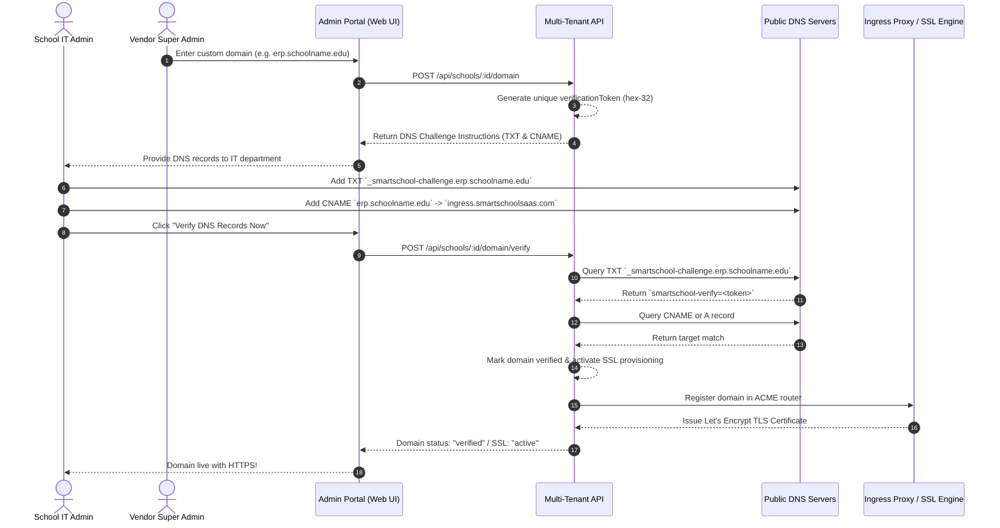

# Commercial Custom Domain Setup & Verification Guide

This guide describes how to configure, verify, and manage white-label custom domains (e.g., `erp.springfieldacademy.edu`) for individual schools on the Smart School Multi-Tenant SaaS platform.

---

## 1. Architecture & Verification Flow

The platform supports both platform subdomains (`<slug>.smartschoolsaas.com`) and custom vanity domains (`erp.schoolname.org`).

To prevent domain hijacking, spoofing, and misrouted traffic, custom domains adhere to a **strict 4-phase lifecycle**:



---

## 2. Step-by-Step Configuration for School IT Administrators

When a school registers a custom domain in the portal, the IT administrator must create two DNS records in their DNS registrar (Cloudflare, GoDaddy, Namecheap, Route 53, Google Cloud DNS, etc.).

### Record 1: Verification Challenge Record (Mandatory)
This cryptographic challenge proves administrative control over the domain before any traffic is routed.

| Type | Name / Host | Value / Target | TTL |
| :--- | :--- | :--- | :--- |
| **TXT** | `_smartschool-challenge.erp.schoolname.edu` | `smartschool-verify=<unique-verification-token>` | 300 (or Auto) |

> [!NOTE]
> If your domain registrar automatically appends your root domain, enter only `_smartschool-challenge.erp` in the **Host/Name** field.

### Record 2: Ingress Routing Record (Mandatory)
This routes browser requests from the school's URL to the SaaS multi-tenant gateway.

#### Option A: For Subdomains (e.g. `erp.schoolname.edu`, `portal.school.k12.us`)
| Type | Name / Host | Value / Target | TTL |
| :--- | :--- | :--- | :--- |
| **CNAME** | `erp` | `ingress.smartschoolsaas.com` | 300 (or Auto) |

#### Option B: For Apex / Root Domains (e.g. `schoolname.edu`)
If your DNS provider supports **CNAME Flattening**, **ALIAS**, or **ANAME** records, point the apex record to `ingress.smartschoolsaas.com`.
Otherwise, configure direct `A` records pointing to the vendor edge IPs:

| Type | Name / Host | Value / Target | TTL |
| :--- | :--- | :--- | :--- |
| **A** | `@` | `198.51.100.24` | 300 |
| **A** | `@` | `198.51.100.25` | 300 |

---

## 3. Triggering Verification in the Super Admin Portal

1. Log in to the **Vendor Super Admin Portal** (`/super-admin/schools`).
2. Select the target school and navigate to the **Custom Domain** tab.
3. If not already registered, enter the domain (e.g. `erp.schoolname.edu`) and click **Save Custom Domain**.
4. The system will display the assigned **Verification Token** and the exact DNS entries required.
5. Once your DNS provider propagates the records, click **Verify DNS Records Now**.
6. The backend DNS service executes live lookups using Node.js `dns/promises`:
   - `resolveTxt(`_smartschool-challenge.${domain}`)`
   - `resolveCname(${domain})`
7. If the records match, the status immediately switches to **Verified**, and the domain is mapped to the school's tenant document.

---

## 4. API Endpoints Reference

Vendor administrators and authorized automated provisioning pipelines can manage domains using the following REST endpoints:

### Configure Custom Domain
```http
POST /api/schools/:id/domain
Authorization: Bearer <super_admin_jwt>
Content-Type: application/json

{
  "domain": "erp.springfield.edu"
}
```

**Response (`200 OK`)**:
```json
{
  "success": true,
  "message": "Custom domain configured. Complete DNS verification to activate.",
  "data": {
    "domain": "erp.springfield.edu",
    "verificationToken": "3d5f8c92a10b42e78345c2f091bc7891",
    "status": "pending_verification",
    "sslStatus": "pending"
  }
}
```

### Trigger Verification
```http
POST /api/schools/:id/domain/verify
Authorization: Bearer <super_admin_jwt>
```

**Successful Response (`200 OK`)**:
```json
{
  "success": true,
  "message": "Domain erp.springfield.edu verified successfully.",
  "data": {
    "domain": "erp.springfield.edu",
    "status": "verified",
    "sslStatus": "active",
    "verifiedAt": "2026-10-13T22:00:00.000Z"
  }
}
```

**Failure Response (`400 Bad Request`)**:
```json
{
  "success": false,
  "error": {
    "code": "DOMAIN_VERIFICATION_FAILED",
    "message": "TXT challenge verification failed for erp.springfield.edu: Expected TXT token smartschool-verify=3d5f8c92... but record was not found."
  }
}
```

### Remove Custom Domain
```http
DELETE /api/schools/:id/domain
Authorization: Bearer <super_admin_jwt>
```

---

## 5. Automated SSL / TLS Certificate Provisioning

The SaaS edge ingress (Traefik or Nginx with Certbot) automatically provisions free, auto-renewing TLS certificates via Let's Encrypt:

1. **ACME Challenge Delegation**: When a verified domain routes traffic to the edge proxy, Traefik's ACME provider receives an SNI handshake or HTTP-01 challenge on `/.well-known/acme-challenge/`.
2. **Dynamic Domain Whitelist**: Traefik queries the API endpoint `GET /api/schools/resolve?host=<domain>` or checks the verified domains database table to ensure certificates are only issued for active, verified tenants.
3. **Automated Renewal**: Certificates are renewed automatically 30 days prior to their 90-day expiry without manual intervention.

---

## 6. Host-Header Validation & Anti-Spoofing Protection

To prevent **Host-Header Injection** and cross-tenant spoofing:
1. The backend middleware inspects `req.headers['x-forwarded-host']` and `req.headers['host']`.
2. The domain is sanitized against a strict regex (`/^[a-z0-9]([a-z0-9-]*[a-z0-9])?(\.[a-z0-9]([a-z0-9-]*[a-z0-9])?)+$/i`).
3. The server executes an exact database query:
   ```typescript
   const school = await School.findOne({
     'customDomain.domain': hostname.toLowerCase(),
     'customDomain.status': 'verified',
     status: 'active'
   });
   ```
4. **Never trust arbitrary client-supplied IDs**: Even if a request arrives with a custom domain host header, any authenticated user must possess a valid cryptographic JWT matching the target school. Any mismatch returns `403 Forbidden` (`TENANT_MISMATCH`).

---

## 7. Troubleshooting & Diagnostics

If verification fails, test DNS records using terminal diagnostic tools:

### Check TXT Challenge Record
```bash
# Linux / macOS
dig TXT _smartschool-challenge.erp.schoolname.edu +short

# Windows PowerShell
Resolve-DnsName -Name "_smartschool-challenge.erp.schoolname.edu" -Type TXT
```
*Expected output:* `"smartschool-verify=YOUR_TOKEN_HERE"`

### Check CNAME Routing Record
```bash
# Linux / macOS
dig CNAME erp.schoolname.edu +short

# Windows PowerShell
Resolve-DnsName -Name "erp.schoolname.edu" -Type CNAME
```
*Expected output:* `ingress.smartschoolsaas.com.`

> [!TIP]
> DNS propagation typically takes between 1 and 15 minutes, but can take up to 48 hours depending on the registrar's nameserver caching policies. If records do not verify immediately, lower your TTL to 300 seconds and retry.
