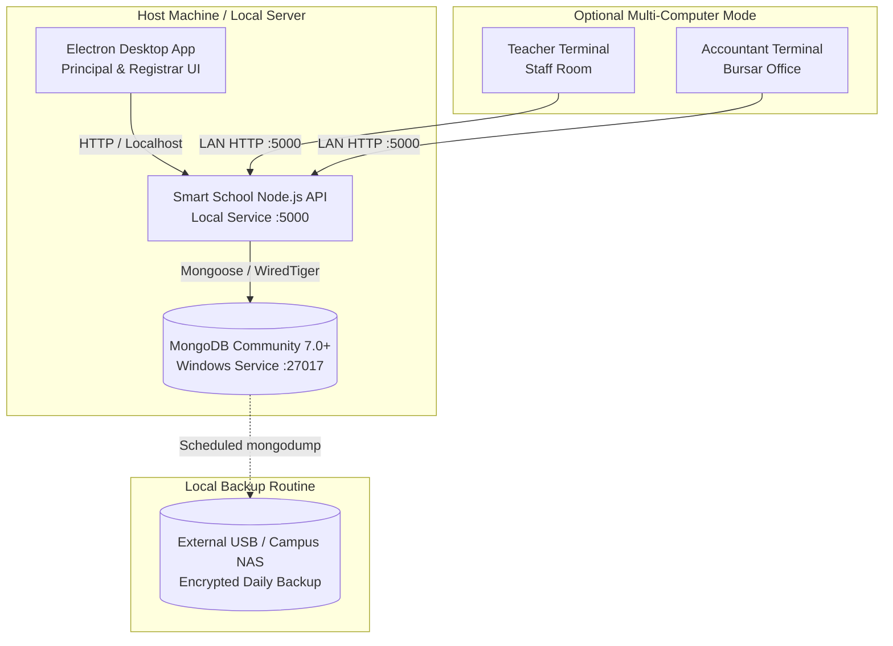

# Commercial Offline Desktop Edition Installation & Operations Guide

This guide describes how to install, provision, license, and operate the **Smart School Management System — Offline Desktop Edition** for independent schools requiring complete on-premises data sovereignty and offline operation without continuous internet access.

---

## 1. Architectural Model & Guarantees

The Offline Desktop Edition is an **independently provisioned single-tenant deployment**.



### Core Offline Principles
1. **Zero Cloud Dependency**: Core workflows (student admissions, record edits, attendance, fee receipt printing, grade entry) execute entirely on campus hardware.
2. **Independent Persistence**: The school uses its own dedicated MongoDB database. Local data does not automatically synchronize to any central vendor database without explicit administrator export.
3. **Shared Business Logic**: The offline edition uses the exact same frontend React components, validation schemas, and API routes as the hosted SaaS platform, ensuring a seamless user experience.

---

## 2. Hardware & Operating System Requirements

### Host Machine / Campus Server
- **Operating System**: Windows 10 (64-bit), Windows 11 (64-bit), or Windows Server 2019/2022
- **Processor**: Intel Core i5 / AMD Ryzen 5 (4 cores, 2.5 GHz or higher)
- **Memory**: 8 GB RAM minimum (16 GB recommended for campuses with >1,000 students)
- **Disk Space**: 20 GB free SSD storage (NVMe recommended for rapid report generation)

### Client Workstations (Optional LAN mode)
- Standard Windows PC or laptop with 4 GB RAM running Chrome, Edge, or the Electron Desktop Client.

---

## 3. Step-by-Step Installation & Setup Walkthrough

### Step 1: Install MongoDB Community Server as a Windows Service

1. Download the official **MongoDB Community Server 7.0+ MSI installer** for Windows.
2. Run the MSI installer and select **Complete Setup**.
3. In the Service Configuration step, verify:
   - Select **Install MongoDB as a Service**.
   - Service Name: `MongoDB`
   - Data Directory: `C:\Program Files\MongoDB\Server\7.0\data`
   - Log Directory: `C:\Program Files\MongoDB\Server\7.0\log`
4. Complete installation and open **PowerShell as Administrator** to verify the service status:
   ```powershell
   Get-Service -Name MongoDB
   ```
   *Expected status: `Running`*

---

### Step 2: Install the Smart School Server Service

1. Extract the vendor-provided release package `smartschool-server-win64.zip` to `C:\SmartSchoolServer`.
2. Configure the local environment file `C:\SmartSchoolServer\.env`:
   ```env
   NODE_ENV=production
   PORT=5000
   MONGODB_URI=mongodb://127.0.0.1:27017/smart_school_offline
   JWT_SECRET=campus_offline_secure_secret_key_9847120381
   JWT_EXPIRES_IN=30d
   REFRESH_TOKEN_SECRET=campus_offline_refresh_secret_key_8172635412
   REFRESH_TOKEN_EXPIRES_IN=90d
   OFFLINE_MODE=true
   CORS_ORIGIN=*
   ```
3. Register the API as an automatic background service using NSSM (Non-Sucking Service Manager):
   ```powershell
   # In Administrator PowerShell:
   cd C:\SmartSchoolServer
   .\tools\nssm.exe install SmartSchoolAPI "C:\Program Files\nodejs\node.exe" "C:\SmartSchoolServer\dist\server.js"
   .\tools\nssm.exe set SmartSchoolAPI AppDirectory "C:\SmartSchoolServer"
   .\tools\nssm.exe set SmartSchoolAPI Start SERVICE_AUTO_START
   Start-Service SmartSchoolAPI
   ```
4. Confirm server health by browsing to `http://127.0.0.1:5000/api/health`.

---

### Step 3: Install the Desktop Electron Client

1. Run the NSIS installer `Smart-School-ERP-Setup.exe`.
2. Follow the on-screen prompts; the installer places a desktop shortcut: **Smart School ERP**.
3. Launch the application.
4. On first launch, the desktop shell connects to `http://127.0.0.1:5000` and displays the **Initial School Setup Wizard**.

---

## 4. Air-Gapped Licensing & Activation

Offline installations do not ping a central billing server. Instead, they utilize **cryptographically signed license files** (`license.key`).

### License Structure
Each license file contains an asymmetric payload signed by the vendor's private key:
```json
{
  "licenseId": "LIC-2026-OFFLINE-0092",
  "schoolName": "St. Jude Grammar School",
  "planType": "annual",
  "maxStudents": 750,
  "maxStaff": 50,
  "features": ["student_records", "attendance", "admissions", "examinations", "fee_collection", "offline_reports"],
  "validFrom": "2026-01-01T00:00:00Z",
  "expiresAt": "2027-01-01T23:59:59Z",
  "gracePeriodDays": 30,
  "signature": "MEQCIFz...[Ed25519 Cryptographic Signature]...=="
}
```

### Applying a License Key
1. Navigate to **School Settings** > **License & Subscription**.
2. Click **Upload License File** or paste the raw license key string.
3. The local server verifies the signature against the embedded vendor public key.
4. Once verified, student quotas and module access are immediately updated.
5. If the license expires, write operations are paused after the grace period, but **export and read access to all student records remains permanently accessible**.

---

## 5. Campus LAN Multi-User Setup (Optional)

To enable teachers and office staff to access the system from their own PCs over the campus Wi-Fi / Ethernet:

1. Determine the campus server's local IPv4 address:
   ```powershell
   ipconfig
   # Example: 192.168.1.100
   ```
2. Open Windows Firewall port 5000 for incoming connections on the local network:
   ```powershell
   # Run in Administrator PowerShell on Server PC:
   New-NetFirewallRule -DisplayName "Smart School LAN Access" -Direction Inbound -LocalPort 5000 -Protocol TCP -Action Allow
   ```
3. On teacher/staff computers, launch any modern browser (Chrome, Edge, Firefox) and navigate to:
   ```
   http://192.168.1.100:5000
   ```
4. Staff can log in using their assigned accounts and work concurrently.

---

## 6. Local Backup & Disaster Recovery Routine

### Automated Daily Backup Script
Save the following script to `C:\SmartSchoolServer\scripts\daily-backup.ps1`:

```powershell
# daily-backup.ps1 - Automated Daily MongoDB Backup
$backupRoot = "D:\SmartSchoolBackups"
$timestamp = Get-Date -Format "yyyy-MM-dd_HHmmss"
$targetDir = "$backupRoot\backup_$timestamp"

if (-not (Test-Path -Path $backupRoot)) {
    New-Item -ItemType Directory -Path $backupRoot -Force | Out-Null
}

Write-Host "Creating local database dump to $targetDir..."
& "C:\Program Files\MongoDB\Server\7.0\bin\mongodump.exe" `
    --uri="mongodb://127.0.0.1:27017/smart_school_offline" `
    --gzip `
    --out="$targetDir"

# Retain backups for 30 days
Get-ChildItem -Path $backupRoot -Directory | Where-Object {
    $_.CreationTime -lt (Get-Date).AddDays(-30)
} | Remove-Item -Recurse -Force

Write-Host "Backup completed successfully."
```

### Scheduling with Windows Task Scheduler
```powershell
# Schedule backup to run every evening at 11:00 PM
$action = New-ScheduledTaskAction -Execute "PowerShell.exe" -Argument "-ExecutionPolicy Bypass -File C:\SmartSchoolServer\scripts\daily-backup.ps1"
$trigger = New-ScheduledTaskTrigger -Daily -At 11:00PM
Register-ScheduledTask -Action $action -Trigger $trigger -TaskName "SmartSchoolDailyBackup" -Description "Daily campus ERP database backup"
```

### Database Restoration Procedure
If the computer is replaced or hardware fails:
```powershell
& "C:\Program Files\MongoDB\Server\7.0\bin\mongorestore.exe" `
    --uri="mongodb://127.0.0.1:27017/smart_school_offline" `
    --gzip `
    --dir="D:\SmartSchoolBackups\backup_2026-10-13_230000\smart_school_offline"
```

---

## 7. Migration Path: Transitioning to the Hosted Cloud SaaS

If a school later decides to transition from the Offline Desktop Edition to the Hosted Cloud SaaS:

1. In the Offline Desktop UI, go to **Settings** > **Data Management** > **Export Complete School Dataset**.
2. Download the encrypted `.schoolpkg` archive (containing JSON documents and uploaded assets).
3. The software vendor imports the package through the **Vendor Super Admin Portal** (`POST /api/schools/import`), which automatically validates unique student admission numbers, maps user credentials, and provisions cloud tenant storage.
